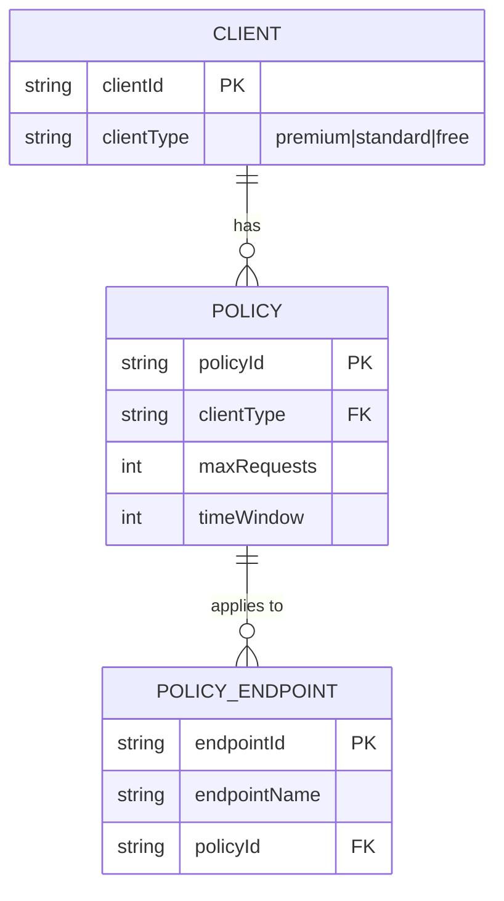

# Rate limiter Service
This project is a Spring Boot application that implements a rate limiter service using Redis as the backend store

# Problem Statement
1. The rate limiter service is designed to limit the number of requests a client can make to an API within a specified time window.
2. Assume auth is handled.
3. The service is implemented for a high volume public API.
## Functional Requirements
1. The service should allow clients to make a max of N requests within a time window of T.
2. The service should limit requests per client based on their unique identifier.
3. The service should return an appropriate response when the rate limit is exceeded.
4. The service policy should be configurable, allowing for different limits and time windows for different clients.
    - The service should support multiple rate limit policies, allowing for different limits and time windows for different clients.
    - Simple based on the client type - premium, standard, free tiers.
6. The service should provide an endpoint to check the current rate limit status for a client.

## Non-Functional Requirements
1. Availability = 99.9%: The service should be highly available and able to handle a large number of concurrent requests.
2. The service should be able to handle DDOS attacks and other malicious activities.
3. The service should be scalable—(1M rps), allowing for horizontal scaling to handle increased load.
4. The service should be secure, ensuring that client identifiers are protected and that rate limit policies cannot be tampered with.
5. The service should be efficient, minimizing latency and resource usage while enforcing rate limits.

## Core Entities
1. Client: Represents a client making requests to the API. Each client has a unique identifier
2. Endpoint: Represents an API endpoint that clients can access. Each endpoint has a unique identifier and may have different rate limit policies.
3. Rate Limit Policy: Defines the maximum number of requests a client can make to an endpoint within a specified time window. Each policy has a unique identifier and may be associated with one or more clients and endpoints.
4. Request: Represents a request made by a client to an endpoint. Each request has a timestamp and is associated with a client and an endpoint.

## API/Interface
1. `isRequestAllowed(clientId, endpointId)`
2. `getRateLimitStatus(clientId, endpointId)`
3. `configureRateLimitPolicy(clientId, endpointId, maxRequests, timeWindow)` (optional)
4. `removeRateLimitPolicy(clientId, endpointId)` (optional)
5. `getRateLimitPolicies(clientId, endpointId)` (optional)

