# Rate Limiter Service

This project explores two ways to enforce rate limits in a Spring-based API gateway:

1. A custom rate limiter, with implementations of algorithms such as fixed-window and token-bucket.
2. Spring Cloud Gateway's built-in `RedisRateLimiter`, which uses Redis to share rate-limit state across gateway instances.

The goal is to implement and compare both approaches. They are separate strategies; a route should normally use one limiter at a time unless applying both is intentional.


# Problem Statement
1. The gateway limits the number of requests a client can make to downstream APIs.
2. Assume auth is handled.
3. The service is implemented for a high volume public API.
## Functional Requirements
1. The service should allow clients to make a max of N requests within a time window of T.
2. The service should limit requests per client based on their unique identifier.
3. The service should return an appropriate response when the rate limit is exceeded.
4. The service policy should be configurable, allowing for different limits and time windows for different clients.
    - The service should support multiple rate limit policies, allowing for different limits and time windows for different clients.
    - Simple based on the client type - premium, standard, free tiers.
5. The gateway should reject requests that exceed the configured limit with HTTP 429.

## Rate-Limiting Approaches

### Custom rate limiter

Implement rate-limiting algorithms behind a common interface so their behavior can be tested and compared. The custom implementation is responsible for calculating whether a request is allowed and maintaining its counter or bucket state. An in-memory implementation is useful for learning and local tests, but it does not share state across gateway instances; use a shared store such as Redis for a distributed deployment.

### Distributed Token Bucket with Redis

If you need to use the custom `TokenBucketCounter` algorithm in a distributed environment (multiple gateway instances), you must replace the in-memory `ConcurrentHashMap` with Redis-backed storage. Here's what changes are required:

#### Changes Needed:

1. **Replace `ConcurrentHashMap` with Redis Hashes** - Store bucket state per client key in Redis instead of memory

2. **Use Lua Scripts for Atomic Operations** - Redis doesn't have atomic `compute-if-absent`; a Lua script handles the entire token bucket logic atomically (refill, check, decrement)

3. **BucketState Serialization** - Store as Redis Hash fields:
   - `tokens` - current token count
   - `epoch_millis` - last refill timestamp

4. **Lua Script Example** (atomic token bucket operation):

   ```lua
   local key = KEYS[1]
   local now = tonumber(ARGV[1])
   local capacity = tonumber(ARGV[2])
   local refill_rate = tonumber(ARGV[3])
   local requested = tonumber(ARGV[4])

   local state = redis.call('HGETALL', key)
   local tokens = 0
   local epoch_millis = now

   if #state > 0 then
       tokens = tonumber(state[2])
       epoch_millis = tonumber(state[4])
   end

   local elapsed = math.max(0, now - epoch_millis)
   local refilled = math.min(capacity, tokens + elapsed * refill_rate)

   local allowed = 0
   if refilled >= requested then
       refilled = refilled - requested
       allowed = 1
   end

   redis.call('HSET', key, 'tokens', refilled, 'epoch_millis', now)

   return {allowed, refilled, now}
   ```

5. **Update `TokenBucketCounter`** to use `StringRedisTemplate` and the Lua script

#### Alternative: Use Redisson

Redisson provides distributed data structures that handle Redis complexity:

```java
RBucket<BucketState> bucket = redisson.getBucket("client:" + clientId);
boolean allowed = bucket.execute((BucketState state) -> {
    // atomic update logic
})
```

#### Redis Configuration

Ensure `application.yml` has Redis configured:

```yaml
spring:
  data:
    redis:
      host: localhost
      port: 6379
```

### Spring Cloud Gateway `RedisRateLimiter`

Configure Gateway's built-in Redis-backed rate limiter on routes. Gateway applies the limit in its request filter pipeline, while Redis stores shared rate-limit state. A `KeyResolver` determines which requests share a limit, ideally using a trusted authenticated client identity. This is the distributed option for multiple gateway instances.

These approaches can be selected per route for comparison. Avoid stacking both on the same route unless two independent layers of limiting are desired and their combined behavior is understood.

## Run the Redis Gateway Simulation

The configured `posts-service` route uses Spring Cloud Gateway's `RedisRateLimiter` with a refill rate of one token per second and a bucket capacity of ten. For local simulation, the `clientKeyResolver` reads `X-Client-Id`; this header is caller-controlled and must not be used as an identity source in production. Replace it with the authenticated principal or a trusted JWT claim when authentication is configured.

1. Start Redis and the mock downstream posts service:

   ```sh
   docker compose up -d
   ```

2. Start the gateway in another terminal:

   ```sh
   ./gradlew bootRun
   ```

3. Send 12 requests with the same client key:

   ```sh
   for i in $(seq 1 12); do
     curl -s -o /dev/null -w "%{http_code}\n" \
       -H "X-Client-Id: demo-client" \
       http://localhost:8080/posts/42
   done
   ```

   The first ten requests should be forwarded and return `200`; requests after the bucket is empty should return `429` until tokens refill. Use a different `X-Client-Id` to test an independent bucket. Stop the local containers with `docker compose down`.

## Non-Functional Requirements
1. Availability = 99.9%: The service should be highly available and able to handle a large number of concurrent requests.
2. The service should be able to handle DDOS attacks and other malicious activities.
3. The service should be scalable—(1M rps), allowing for horizontal scaling to handle increased load.
4. The service should be secure, ensuring that client identifiers are protected and that rate limit policies cannot be tampered with.
5. The service should be efficient, minimizing latency and resource usage while enforcing rate limits.


## Core Entities
1. Client: Represents a client making requests to the API. Each client has a unique identifier
2. Endpoint: Represents an API endpoint that clients can access. Each endpoint has a unique identifier and may have different rate limit policies.
3. Rate Limit Policy: Defines the maximum number of requests a client can make to an endpoint within a specified time window. Each policy has a unique identifier and may be associated with one or more clients and endpoints.
4. Request: Represents a request made by a client to an endpoint. Each request has a timestamp and is associated with a client and an endpoint.

## API/Interface
1. `isRequestAllowed(clientId, endpointId)`
2. `getRateLimitStatus(clientId, endpointId)`
3. `configureRateLimitPolicy(clientId, endpointId, maxRequests, timeWindow)` (optional)
4. `removeRateLimitPolicy(clientId, endpointId)` (optional)
5. `getRateLimitPolicies(clientId, endpointId)` (optional)

```mermaid
erDiagram
   CLIENT{
        string clientId PK
        string clientType "premium|standard|free"
    }
    POLICY{
        string policyId PK
        string clientType FK
        int maxRequests
        int timeWindow
    }
    POLICY_ENDPOINT{
        string endpointId PK
        string endpointName
        string policyId FK
    }
    CLIENT ||--o{ POLICY : "has"
    POLICY ||--o{ POLICY_ENDPOINT : "applies to"

```



